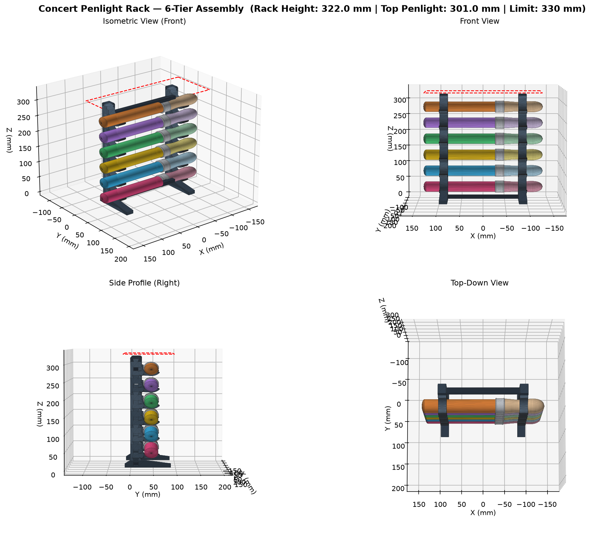
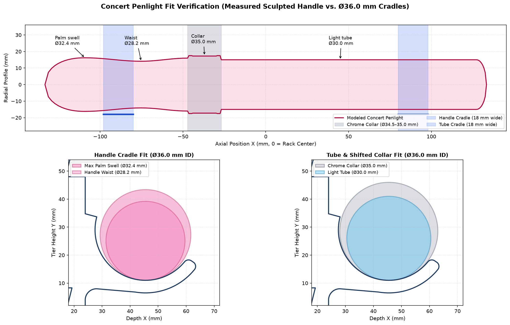
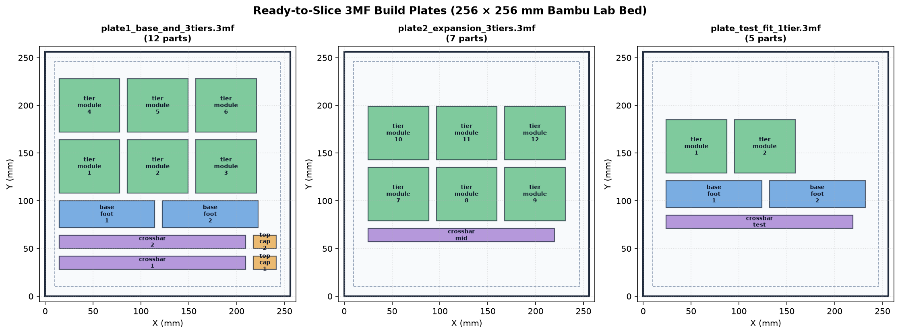
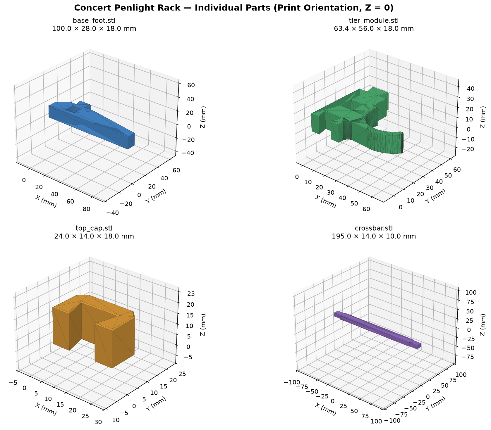
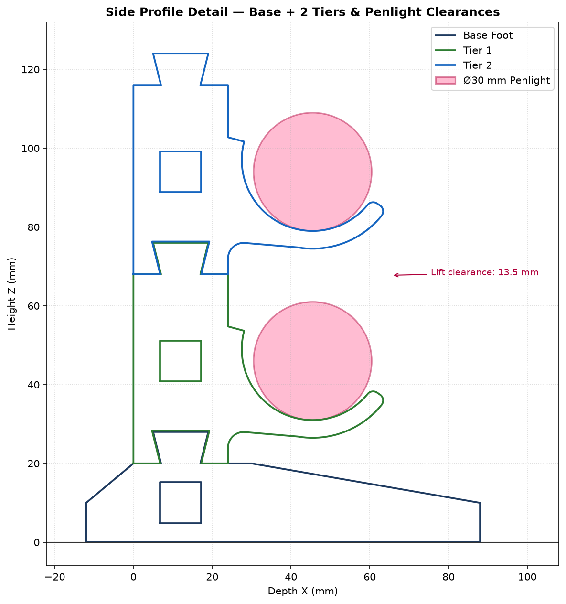

# Modular Concert Penlight Display Rack

A modular, katana-style horizontal display rack for storing and showcasing standard cylindrical concert penlights (~30 mm tube diameter, ~250–270 mm length).

Stack anywhere from **1 to 6 tiers** using tool-free sliding dovetail joints and mortise-and-tenon crossbars—staying comfortably within a **33 cm (330 mm) maximum height** (ideal for shelves and IKEA Kallax cubes).



## Compatible With

- **RUIFAN KingBlade** series (standard cylindrical tube & sculpted ergonomic concert penlight handles, ~Ø30 mm tube, up to ~Ø35 mm collar/grip)
- Other cylindrical concert penlights / glowstick wands up to **Ø35 mm** diameter and at least **200 mm** long

## Key Dimensions

- **Reference penlight**: Measured concert penlight (`266.5 mm` total length: `Ø30.0 mm` light tube, `Ø34.5–35.0 mm` chrome collar, sculpted ergonomic handle with `Ø28.2 mm` waist and `Ø32.4 mm` palm swell)
- **Cradle bore**: `Ø36.0 mm` inner diameter (clears the tube, sculpted palm swell, and even the collar if shifted off-center)
- **Tier pitch**: `48.0 mm` per tier (`13.5 mm` vertical lift clearance above the `Ø30 mm` tube; `7.9 mm` front lip)
- **Footprint**: `196.0 mm` wide × `100.0 mm` deep (`160.0 mm` inner span between towers)
- **Total height by tier count** *(including base foot and top cap)*:
  - 1 tier: 82.0 mm
  - 2 tiers: 130.0 mm
  - 3 tiers: 178.0 mm
  - 4 tiers: 226.0 mm
  - 5 tiers: 274.0 mm
  - **6 tiers: 322.0 mm** *(top penlight collar peaks at 306.0 mm—24.0 mm clearance under a 330 mm ceiling)*

## Fit Verification

A parametric reference model of the sculpted concert penlight ([`src/penlight.py`](src/penlight.py)) is used to verify both axial positioning and cross-section clearance at the handle and tube cradles:



## Ready-to-Slice 3MF Build Plates (256 × 256 mm)

Open any of these pre-arranged `.3mf` files directly in **Bambu Studio** and slice—all parts are oriented flat on `Z = 0` with `8 mm` spacing and generous bed margins (no supports required):

| Plate | File | Contents | Footprint on Bed |
| --- | --- | --- | --- |
| **Plate 1 (Base + 3 Tiers)** | `exports/plate1_base_and_3tiers.3mf` | 2× `base_foot`, 2× `crossbar`, 2× `top_cap`, 6× `tier_module` (complete 3-tier rack) | 227.0 × 200.0 mm |
| **Plate 2 (+3 Tier Expansion)** | `exports/plate2_expansion_3tiers.3mf` | 6× `tier_module` + 1× optional middle `crossbar` (expands to full 6-tier rack) | 206.2 × 142.0 mm |
| **Test-Fit Plate (1 Tier)** | `exports/plate_test_fit_1tier.3mf` | 2× `base_foot`, 2× `tier_module`, 1× `crossbar` (quick tolerance & penlight fit check) | 208.0 × 114.0 mm |



## Parts & Print Quantities

All parts are oriented flat on `Z = 0` for **support-free** FDM printing and fit comfortably on a **256 × 256 mm** build plate (e.g., Bambu Lab A1 / P1 / X1):

| Part | File | Dimensions (mm) | Qty for *N* Tiers (6 Tiers) |
| --- | --- | --- | --- |
| Base Foot | `exports/base_foot.stl` | 100.0 × 28.0 × 18.0 | 2 (2) |
| Tier Module | `exports/tier_module.stl` | 63.4 × 56.0 × 18.0 | 2 × *N* (12) |
| Top Cap | `exports/top_cap.stl` | 24.0 × 14.0 × 18.0 | 2 (2) |
| Crossbar | `exports/crossbar.stl` | 195.0 × 14.0 × 10.0 | 2–3 (2 recommended: base + top tier) |

*(STEP files are also provided in `exports/` alongside STLs.)*



## Assembly Instructions

No screws or glue are required (uses a 0.20 mm per-side snug slip fit; a dab of CA glue can be added if you want a permanent bond):

1. Slide the first **Tier Module** sideways onto each **Base Foot** dovetail until flush.
2. Stack additional **Tier Modules** up to your desired height (up to 6 tiers for ≤ 330 mm).
3. Slide a **Top Cap** onto the top dovetail of each tower.
4. Connect the Left and Right towers by inserting a **Crossbar** through the square mortise in the **Base Foot** and another **Crossbar** through the top **Tier Module** (add a third crossbar in a middle tier if you want extra rigidity).



## Recommended Print Settings

- **Material**: PLA or PETG
- **Nozzle**: 0.4 mm
- **Layer height**: 0.20 mm
- **Wall loops / perimeters**: 3–4 (≥ 1.2–1.6 mm walls)
- **Infill**: 15–20% Gyroid or Grid
- **Supports**: None required
- **Orientation**: Print all parts as exported (flat on `Z = 0`)
- **Batching tip**: Up to 6–8 `tier_module` parts fit on a single 256 × 256 mm plate.

## Regenerating the Models

All dimensions are parameterized at the top of [`src/generate.py`](src/generate.py). To rebuild all `.stl`, `.step`, `.3mf`, and preview renders from scratch:

```bash
uv run python projects/concert-penlight-rack/src/generate.py
```
