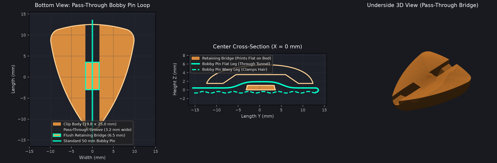
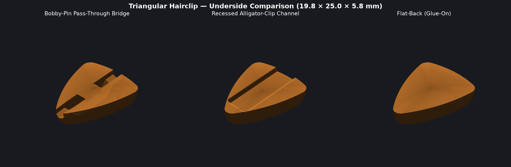

# Triangular Hairclip

A smooth, curved triangular domed hairclip (`19.8 × 25.0 × 5.8 mm`) with three mounting variants—highlighted by a **support-free pass-through bobby-pin bridge** that lets a standard 50 mm (2-inch) bobby pin slide cleanly through from either end. Ideal for Setsuna Yuki cosplay.

**[Interactive 3D Preview](https://monahanc.github.io/3d-printing/triangular-hairclip/)**



## Variants

| Variant | File | Mounting Method |
| --- | --- | --- |
| **Bobby-Pin Bridge** *(Recommended)* | `exports/triangular_hairclip_bobbypin.stl` | Pass-through `3.2 mm` underside groove + flush `6.5 × 1.05 mm` retaining bridge and self-supporting pitched tunnel for a standard 50 mm bobby pin (no glue needed). |
| **Alligator-Clip Recess** | `exports/triangular_hairclip_recessed.stl` | Open-top `6.4 × 20.0 × 0.85 mm` underside channel for gluing a metal alligator clip. |
| **Flat Back** | `exports/triangular_hairclip_flat.stl` | Solid flat underside for general glue-on mounting. |



## Key Dimensions

- **Overall size**: `19.8 mm` wide × `25.0 mm` long × `5.8 mm` tall
- **Bobby-pin channel**: `3.2 mm` wide (tapering gently to `2.7 mm` near the bottom tip to keep walls strong), `1.05 mm` flush retaining bridge resting flat on `Z = 0`, `3.15–3.55 mm` pitched tunnel ceiling
- **Alligator-clip channel**: `6.4 mm` wide × `20.0 mm` long × `0.85 mm` deep, open at the top edge for the clip pinch tab

## Recommended Print Settings

- **Material**: PLA or PETG (orange / tangerine filament)
- **Nozzle**: 0.4 mm (or 0.2 mm for an ultra-smooth domed surface)
- **Layer height**: **0.12 mm** (recommended for smooth dome curvature and crisp internal bridge/tunnel)
- **Wall loops / perimeters**: 3–4
- **Infill**: 20% Gyroid (or 100%—each clip is only ~1.3 cm³)
- **Supports**: **None required** (the bobby-pin retaining bridge prints flat on `Z = 0` and the internal tunnel roof is pitched to be self-supporting)
- **Orientation**: Flat side down (`Z = 0`), dome facing up

## Regenerating the Models

All dimensions are parameterized at the top of [`src/generate.py`](src/generate.py). To rebuild all `.stl` exports and preview renders from scratch:

```bash
uv run python projects/triangular-hairclip/src/generate.py
```
